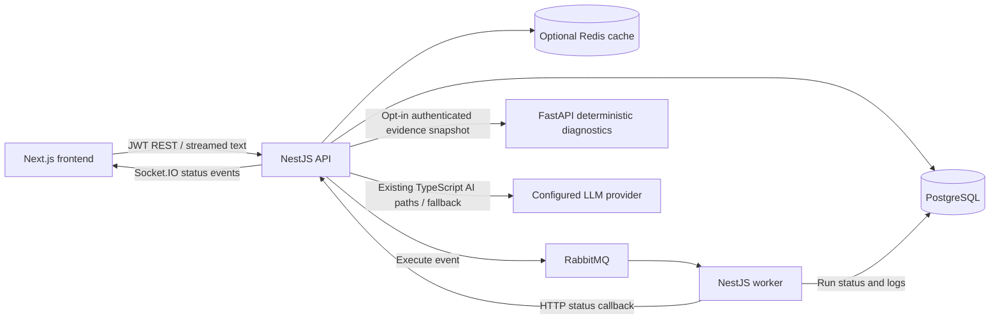

# EWAP architecture review

Reviewed November 13, 2026 against commit `9a9f362b` and the current working tree.
This is a source-level review, not a penetration test or an audit of deployed AWS
configuration. Findings describe reachable application code; network restrictions
outside the repository may affect external exposure. No production services or
databases were accessed. The existing uncommitted roadmap edits were preserved.

Remediation update: H1 membership and H2 status-channel hardening have been
implemented and verified locally after this review; neither has been deployed.
See [membership authorization](membership-authorization.md) and
[workflow status security](workflow-status-security.md). Original findings below
document the reviewed baseline; H4–H9 remain pending in the roadmap queue.

## Current service boundaries

The modular NestJS API, asynchronous worker, PostgreSQL system of record, optional
Redis cache, and stateless Python diagnostic boundary fit the product. Python
does not need database access. Separate worker execution is appropriate for
long-running jobs. A new message platform, GraphQL layer, gRPC boundary, or extra
agent service is not needed to fix the issues below.

The worker currently executes a timed wait before success; its actual workflow
step/executor contract remains an implementation gap. Retry/DLQ code already
exists, so the root README's description of all retry/DLQ work as future work is
outdated. Existing knowledge models do not establish a complete RAG pipeline.

## Findings, ordered by priority

### P0 / H1 addressed locally — Public registration permitted joining an existing tenant

[`UserController`](../api/src/user/user.controller.ts#L17) accepts an organization
ID without a guard. [`UserService.create`](../api/src/user/user.service.ts#L18)
checks that organization exists, then creates an account there. There is no
invitation or administrator authorization. The public organization list exposes
organization IDs. An unauthenticated caller can create their own account in an
existing organization and then use normal password login to obtain a JWT for it.
That bypasses the assumed trust behind otherwise tenant-scoped data endpoints.
Public user read endpoints also expose account details without authorization.

Recommended change: separate public organization/account bootstrap from membership
management. Require an authorized administrator or a tenant-bound, expiring,
single-use invitation to join an existing organization. Scope user reads to the
authenticated tenant. Make first-admin assignment atomic; count-then-create at
default transaction isolation also permits a concurrent bootstrap race.

Verification to add: anonymous membership creation fails; another tenant's admin
cannot add/read users; valid invitations work once; concurrent bootstrap creates
exactly the intended administrator membership.

### P1 / H2 addressed locally — Worker status ingress and WebSocket egress lacked trust boundaries

[`workflow-runs/status`](../api/src/workflow-run/workflow-run.controller.ts#L69)
is explicitly public and broadcasts the submitted state before invalidating
caches. [`WorkflowGateway`](../api/src/workflow/workflow.gateway.ts#L30) emits to
every connected socket, with no socket authentication or organization rooms.
The frontend socket connection sends no JWT. A reachable caller can forge UI
status events and cause cache invalidation; socket clients can receive other
tenants' run IDs and statuses. This callback does not itself update database status.
CORS does not provide socket identity or organization authorization.

Recommended change: authenticate worker callbacks independently from browser JWTs,
derive the organization from the persisted run, validate event identity/state,
invalidate caches before emitting, and publish only to authenticated tenant rooms.
Use a cross-instance Socket.IO adapter or another fan-out mechanism before scaling
API replicas; a local `server.emit` reaches only that process's clients.

Verification to add: missing worker credentials rejected; forged/out-of-order
events rejected or reconciled against database state; tenant B receives no tenant
A event; cache reads after a notification reflect the current persisted state.

### P1 — Notification failures corrupt execution state or strand runs

Partial remediation during H2: the authenticated worker notification client now
reports delivery failure without throwing into execution state handling. The
SUCCESS-overwrite/initial-notification exception paths described below are
addressed by that change. Claim/log-write crash recovery, durable delivery, and
attempt identity remain open H4 items. The following describes the baseline.

[`executeWorkflow`](../worker/src/workflow-consumer/workflow-consumer.service.ts#L15)
claims RUNNING before log creation and the initial notification, both outside the
execution try/catch. If either fails, retries require FAILED, encounter RUNNING,
and skip execution. The controller then ACKs the skipped delivery. A process crash
after claiming RUNNING has the same missing-recovery problem.

After execution, SUCCESS is saved before `notifyStatus`. If that HTTP call fails,
the catch block overwrites SUCCESS with FAILED and schedules an execution retry.
The database outcome becomes incorrect because event delivery failed. For future
side-effecting steps this can also repeat work that already succeeded. Notifications
have no request timeout.

Recommended change: separate run execution from status-event delivery. Persist
outcome plus an event atomically, retry event delivery independently, and add a
recoverable claim/lease or heartbeat with attempt identity and idempotent steps.
Do not make a completed execution fail because its UI notification failed.

Verification to add: failures at claim/log/notify boundaries, crash recovery after
RUNNING, lost success notifications, stale attempts, and duplicate deliveries.

### P1 — Database creation and broker publication are not atomic

[`WorkflowRunService.create`](../api/src/workflow-run/workflow-run.service.ts#L111)
commits PENDING before publishing. Broker failure leaves a persisted run without
a dispatch record; a client retry may create a second run. This is distinct from
the documented intentional behavior when messaging is disabled.

Recommended change: use a transactional outbox for the run and dispatch event,
confirmed asynchronous publication, and request idempotency for run creation.
Keep a visible dispatch state and recovery path rather than relying on an HTTP
retry to repair a partially completed operation.

### P1 — Retry/DLQ ACK occurs without publication confirmation

[`RabbitMqPublisherService`](../worker/src/messaging/rabbitmq-publisher.service.ts#L39)
uses an ordinary channel. Its async publish methods return after `channel.publish`,
without a broker confirmation. The controller then ACKs the original message.
A connection failure can lose the retry/DLQ handoff. `persistent: true` does not
prove that the broker accepted the replacement message. Publisher disconnects
are logged, with no reconnection/recreation path in this service.

Recommended change: publisher confirms, unroutable-message handling, bounded
reconnect, and explicit backpressure/prefetch. ACK the original only after a
confirmed handoff; handle failed handoff without losing the original delivery.

Verification to add: disconnect between publish and confirmation, missing routing,
publish backpressure, publisher reconnect, and retry/DLQ handoff failures.

### P1 — API image startup requires a file the image excludes

H3 follow-up: fixed and locally verified November 14, 2026. The production API
image starts with injected DB fields and no `.env`/DATABASE_URL; see
[configuration](api-configuration.md) and the [roadmap](engineering-roadmap.md).
The following describes the reviewed baseline.

[`main.ts`](../api/src/main.ts#L5) calls `process.loadEnvFile()` unconditionally
before importing AppModule. The Docker context excludes `.env`, and the runtime
stage does not copy one. Supplying environment variables alone therefore does
not satisfy this startup path: a missing `.env` causes ENOENT before Nest boots.
An external file mount could change that, but none is declared in the repository's
API Compose configuration.

A separate Node 24 process in a directory without `.env` reproduced ENOENT. The
API image was not rebuilt or deployed during this review.

Recommended change: make the local dotenv file optional and validate actual
environment variables. Add an image-startup test using injected variables and
no `.env` file. Keep API/worker Node versions and startup conventions explicit.
Also align configuration validation with runtime database configuration: production
uses DB_HOST/DB_NAME/etc., while startup currently requires DATABASE_URL.

### P2 — Chat persistence is not bound to the authorized run

[`createConversation`](../api/src/ai/ai-conversation.service.ts#L9) takes a user
and arbitrary run ID without checking tenant ownership. The streaming controller
creates a conversation and saves the user message before authorized run lookup.
Existing-conversation reads check user ownership, but do not require its
workflowRunId to match the current request. This permits invalid cross-run
conversation associations and mixes one run's history with another run's context.

[`AiService.buildPrompt`](../api/src/ai/ai.service.ts#L90) also ignores an unsuccessful
tool result and can call the LLM with missing run data. The new Python diagnostic
facade correctly rejects an inaccessible run first; that behavior is not shared
by the older chat path.

Recommended change: authorize the run before conversation writes or provider calls;
bind every conversation operation to user, organization, and run. Reject failed
evidence lookup explicitly. Return the same non-disclosing inaccessible-run result.

### P2 — Stream cancellation and completion are not modeled end to end

The browser aborts its fetch, but [`AiController.askStream`](../api/src/ai/ai.controller.ts#L81)
does not propagate disconnect to the provider. The provider contract has no signal,
usage, or terminal-state result. The endpoint sends plain text, not SSE events;
on failure after headers it ends the stream without an explicit failed terminal
event. A client can treat a truncated answer as completed, and provider work can
continue after the user stops reading. Normal completion alone persists the
assistant message; interrupted-request state is not represented.

Recommended change: define typed stream events and one terminal-state rule,
propagate cancellation where supported, bound input/history/output/deadlines, and
record actual usage and completion/failure/cancellation. SSE is a reasonable
transport option, but adopting its name alone does not solve lifecycle handling.

### P2 — Cache invalidation and diagnostic freshness need stronger contracts

[`RedisService.flushPattern`](../api/src/redis/redis.service.ts#L135) uses KEYS and
deletes all matched keys in one request. Run updates invalidate organization-wide
run caches. This grows with the shared keyspace and creates avoidable churn. A
read begun before invalidation can also refill an older value afterward.

Integration diagnostic cache keys contain organization, external run, and question,
but no evidence or prompt/model version. New integration events do not invalidate
those answers, so a prior diagnosis (including "no evidence") can remain cached
for five minutes after new evidence arrives.

Recommended change: explicit per-run/per-workflow invalidation or versioned keys,
bounded SCAN-based maintenance where pattern deletion remains necessary, and
evidence/version-aware diagnostic cache entries. Optional-cache fail-open behavior
should not automatically become the failure policy for the upcoming rate limiter.

## Additional ownership and deployment observations

- API and worker both write the shared domain database. Keep one authoritative
  schema/migration owner. Their checked-in Prisma schemas already differ in
  KnowledgeChunk fields and analytics indexes. Shared generated contracts can
  help, without requiring another service or an immediate monorepo tool change.
- The production Prisma adapter disables TLS certificate verification. Configure
  the database CA and validate the server certificate before production deployment.
- Health currently reports process information, not dependency readiness. Define
  which dependencies prevent serving traffic and test readiness accordingly.
- Python's service key, bounded snapshot, deadline, response validation, and no-DB
  boundary are useful controls. Its fallback is an LLM path with separate cost and
  latency; a Python timeout does not impose an overall diagnostic deadline.
- Analytics applies tenant predicates and parameterized SQL and has real database
  tests. Those guarantees assume membership/JWT issuance is trustworthy; the P0
  registration path undermines that assumption until fixed.

## Recommended implementation sequence

1. Repair membership/user access, worker callback authentication, and socket tenant isolation.
2. Repair environment-only container startup and add the relevant startup test.
3. Implement run/dispatch outbox and reliable execution claims/event delivery;
   confirm retry/DLQ publication and exercise crash/disconnect cases.
4. Add the planned Redis rate limiting, then chat binding and stream lifecycle fixes.
5. Continue Python LLM functionality, operational visibility, and deployment work
   against explicit acceptance tests.

The initial review changed no application code and attempted no exploit against
a running deployment. The subsequent approved hardening queue now governs work;
H1/H2 remediation and partial H4 notification decoupling are tracked above. The
remaining findings are not claimed fixed.
